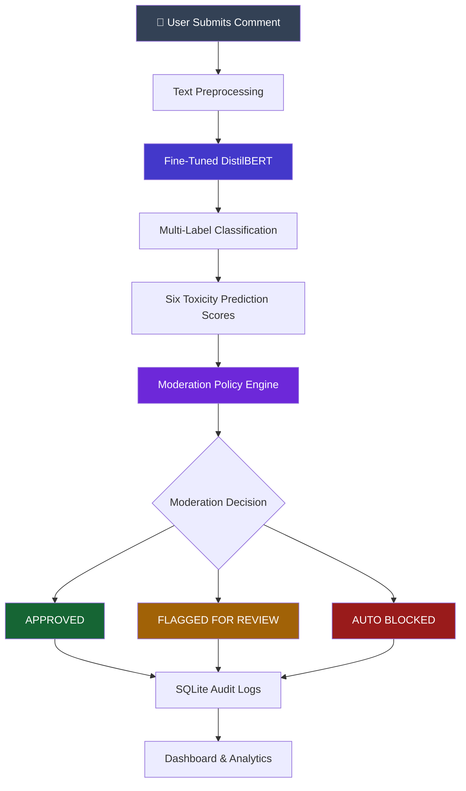

# 🛡️ AI-Powered Content Moderation System

  
  
  
  
  

  <b>Making online spaces safer, one comment at a time.</b>
   
  An intelligent, AI-driven system that detects, classifies, and moderates toxic online comments using Natural Language Processing and Deep Learning.

  
  

---

## 📌 Project Overview

The rapid growth of online communities has made it increasingly difficult to maintain safe and respectful digital environments. Millions of comments are shared across online platforms, and some contain toxic, abusive, or hateful language.

**AI-Powered Content Moderation System** addresses this challenge by using machine learning and Natural Language Processing (NLP) to automatically identify harmful language and assist in content moderation.

The system uses a fine-tuned **DistilBERT transformer model** to analyze comments and perform **multi-label toxicity classification** across six different categories.

Unlike a simple keyword-based filter, the model analyzes the context of text to identify different forms of toxic language. Based on its predictions and moderation policies, the system generates an appropriate moderation decision.

### 🎯 What Does the System Detect?

The system identifies six categories of toxic or harmful language:

<table>
  <tr>
    <td width="50%">
      <h3>🔴 01. Toxic</h3>
      General harmful, hostile, or disrespectful language that creates an unpleasant interaction.
    </td>
    <td width="50%">
      <h3>🚨 02. Severe Toxic</h3>
      Extremely aggressive, abusive, or highly harmful language.
    </td>
  </tr>
  <tr>
    <td width="50%">
      <h3>🔞 03. Obscene</h3>
      Vulgar, explicit, or inappropriate expressions.
    </td>
    <td width="50%">
      <h3>⚠️ 04. Threat</h3>
      Language expressing intimidation, threats, or intentions to cause harm.
    </td>
  </tr>
  <tr>
    <td width="50%">
      <h3>💬 05. Insult</h3>
      Offensive, demeaning, or insulting statements directed towards others.
    </td>
    <td width="50%">
      <h3>🌐 06. Identity Hate</h3>
      Hateful or discriminatory language targeting individuals based on their identity.
    </td>
  </tr>
</table>

**Important:** These categories are independently evaluated. A single comment can belong to multiple categories at the same time.

---

## ⚡ Explore the Live Application

  

The application provides an interactive dashboard where users can:

- Submit comments for toxicity analysis.
- View predicted toxicity categories.
- Examine category-wise prediction scores.
- See automated moderation decisions.
- Explore moderation statistics and audit logs.

**Try it here:** https://content-moderation-system-nf9s.onrender.com/

---

## ✨ Key Features

| Feature | Description |
|:---|:---|
| 🧠 AI-Powered Detection | Uses fine-tuned DistilBERT for contextual toxicity classification. |
| 🏷️ Multi-Label Classification | Detects multiple toxicity categories in a single comment. |
| 📊 Prediction Scores | Displays category-wise toxicity scores. |
| ⚡ Automated Moderation | Generates moderation decisions based on prediction scores and policy rules. |
| 🖥️ Interactive Dashboard | Provides a clean interface for comment analysis and monitoring. |
| 📦 Batch Moderation | Supports processing multiple comments through the API. |
| 🗄️ Audit Logging | Stores moderation activity using SQLite and SQLAlchemy. |
| 📈 Moderation Analytics | Provides statistics about processed comments and moderation outcomes. |
| 🔌 REST API | Provides endpoints for moderation and retrieving system information. |

---

## 🏗️ How It Works

The system follows a complete machine learning pipeline, starting from data exploration and preprocessing to model training, prediction, and automated moderation.

### Moderation Decisions

The system generates three possible moderation outcomes:

| Decision | Meaning |
|:---|:---|
|  | The comment is considered acceptable under the moderation policy. |
|  | The comment requires additional attention or review. |
|  | The comment meets the configured criteria for automatic blocking. |

---

## 🧪 Model Development Pipeline

The project was developed through four major machine learning stages.

### Stage 1 — Exploratory Data Analysis (EDA)

**File:** `stage1_eda.py`

- Explores the dataset and its structure.
- Analyzes the distribution of toxicity labels.
- Identifies class imbalance.
- Studies the co-occurrence of different toxicity categories.

### Stage 2 — Text Preprocessing

**File:** `stage2_clean.py`

- Cleans raw text.
- Expands contractions.
- Normalizes repeated characters.
- Performs stratified training and validation splitting.

### Stage 3 — Machine Learning Baseline

**File:** `stage3_baseline.py`

- Uses TF-IDF for text feature extraction.
- Incorporates word and character n-grams.
- Trains Logistic Regression classifiers for the six toxicity labels.
- Establishes a baseline for comparison with the transformer model.

### Stage 4 — Transformer Model Training

**File:** `stage4_transformer.py`

- Uses `distilbert-base-uncased`.
- Fine-tunes the transformer for multi-label classification.
- Uses PyTorch and Hugging Face Transformers.
- Implements `BCEWithLogitsLoss` for multi-label learning.

The trained model is then integrated into the moderation service for comment analysis.

---

## 🛠️ Technology Stack

<table>
  <tr>
    <th>Category</th>
    <th>Technologies</th>
  </tr>
  <tr>
    <td><b>Programming Language</b></td>
    <td>Python</td>
  </tr>
  <tr>
    <td><b>Machine Learning</b></td>
    <
